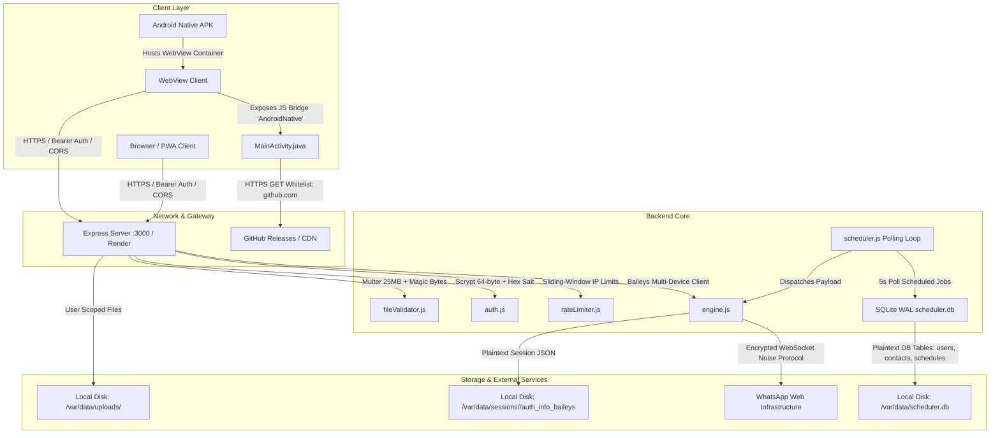
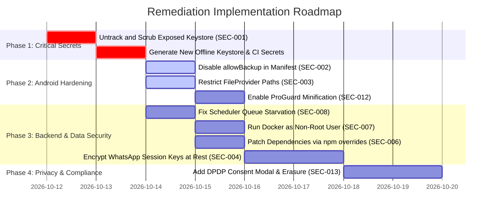

# Comprehensive Pre-Production Security Audit Report

**Target Application:** WhatsApp Scheduler Ecosystem (Android APK, Express Backend, PWA Client, Baileys WhatsApp Engine)  
**Assessed Repository:** `PannagaJA/Whatsapp-Scheduler`  
**Audit Date:** October 12, 2026  
**Auditor:** Senior Application Security Engineer, Mobile Security Auditor & DevSecOps Specialist  
**Assessment Type:** Comprehensive Pre-Production Source Code, Mobile Client & Infrastructure Security Audit  
**Production Readiness Verdict:** 🛑 **NOT PRODUCTION READY — CRITICAL VULNERABILITIES & COMPROMISED KEYSTORE PRESENT**

---

## 1. Executive Summary

A comprehensive pre-production security assessment was conducted on the entire WhatsApp Scheduler codebase. The ecosystem comprises:
1. **Android Native Client:** Java WebView container with native bridge capabilities ([`MainActivity.java`](file:///Users/pannagaja/Desktop/Projects/Whatsapp-Scheduler/android/app/src/main/java/com/whatsapp/scheduler/MainActivity.java), [`AndroidManifest.xml`](file:///Users/pannagaja/Desktop/Projects/Whatsapp-Scheduler/android/app/src/main/AndroidManifest.xml), Gradle build scripts).
2. **Backend API Server:** Node.js Express service ([`server.js`](file:///Users/pannagaja/Desktop/Projects/Whatsapp-Scheduler/mobile-server/server.js)).
3. **Authentication & Multi-Tenant Access Control:** Scrypt password hashing, session tokens, and admin bootstrapping ([`auth.js`](file:///Users/pannagaja/Desktop/Projects/Whatsapp-Scheduler/mobile-server/auth.js)).
4. **WhatsApp Multi-Device Engine:** Baileys WebSocket companion client integration ([`engine.js`](file:///Users/pannagaja/Desktop/Projects/Whatsapp-Scheduler/mobile-server/engine.js)).
5. **Database Layer:** SQLite with WAL mode and composite indexing ([`db.js`](file:///Users/pannagaja/Desktop/Projects/Whatsapp-Scheduler/mobile-server/db.js)).
6. **Task Scheduler:** Background queue polling and message dispatch loop ([`scheduler.js`](file:///Users/pannagaja/Desktop/Projects/Whatsapp-Scheduler/mobile-server/scheduler.js)).
7. **Input Validation & Security Middleware:** File extension and magic-byte validator ([`fileValidator.js`](file:///Users/pannagaja/Desktop/Projects/Whatsapp-Scheduler/mobile-server/fileValidator.js)) and in-memory sliding-window rate limiters ([`rateLimiter.js`](file:///Users/pannagaja/Desktop/Projects/Whatsapp-Scheduler/mobile-server/rateLimiter.js)).
8. **Deployment & CI/CD Pipelines:** Render blueprint configuration ([`render.yaml`](file:///Users/pannagaja/Desktop/Projects/Whatsapp-Scheduler/render.yaml)), container definition ([`Dockerfile`](file:///Users/pannagaja/Desktop/Projects/Whatsapp-Scheduler/mobile-server/Dockerfile)), and GitHub Actions ([`build-apk.yml`](file:///Users/pannagaja/Desktop/Projects/Whatsapp-Scheduler/.github/workflows/build-apk.yml)).

### Core Assessment Findings

While significant defensive hardening has occurred (such as the introduction of Scrypt password hashing, session token verification, file type validation, and rate limiting), several **high-risk and critical vulnerabilities remain active**:

- **Comprehensively Compromised Android Release Keystore:** The release signing keystore `app-release.jks` remains tracked directly in Git (`git ls-files`), and its original plaintext password `***REDACTED***` was permanently committed in historical commit `1a5f2791471dc852393364728c45d0d4d2ae49d8`. Furthermore, local configuration files containing new passwords reside unencrypted in the working tree.
- **Insecure Android Sandbox Backup (`android:allowBackup="true"`):** Physical or ADB access allows full extraction of application databases, WebView local storage (including plaintext auth tokens), and cached session state.
- **Broad FileProvider Permissions:** The FileProvider configuration maps all root directories (`.`), exposing excessive internal storage domains to external applications.
- **Plaintext WhatsApp Credentials at Rest:** Authentication credentials (`creds.json`, app keys, noise keys) for linked WhatsApp accounts are stored unencrypted in server directories (`/var/data/sessions/<userId>/auth_info_baileys/`).
- **Critical Dependency Vulnerabilities:** `npm audit` reports 7 vulnerabilities (1 Critical, 4 High, 2 Low) in `sqlite3 -> node-gyp -> tar` allowing arbitrary file overwrite and symlink poisoning.
- **Docker Root Execution:** The production container executes as `root`, exposing host-level attack surfaces in the event of an application compromise.
- **Scheduler Queue Starvation (Head-of-Line Blocking):** The background scheduler query selects jobs with a static `LIMIT 10` without fair scheduling across users, causing failing jobs from one user to block other users' scheduled messages (confirmed by test failure in `audit-verification.test.js`).
- **Regulatory Privacy Concerns (DPDP Act):** Contact harvesting imports entire address books without explicit consent disclosures, data retention bounds, or self-service deletion workflows.

---

## 2. Scope and Methodology

### Scope of Audit
- **Source Code Inspected:**
  - Android Client: [`android/app/src/main/AndroidManifest.xml`](file:///Users/pannagaja/Desktop/Projects/Whatsapp-Scheduler/android/app/src/main/AndroidManifest.xml), [`android/app/src/main/java/com/whatsapp/scheduler/MainActivity.java`](file:///Users/pannagaja/Desktop/Projects/Whatsapp-Scheduler/android/app/src/main/java/com/whatsapp/scheduler/MainActivity.java), [`android/app/build.gradle`](file:///Users/pannagaja/Desktop/Projects/Whatsapp-Scheduler/android/app/build.gradle), [`android/signing.properties`](file:///Users/pannagaja/Desktop/Projects/Whatsapp-Scheduler/android/signing.properties).
  - Backend Services: [`mobile-server/server.js`](file:///Users/pannagaja/Desktop/Projects/Whatsapp-Scheduler/mobile-server/server.js), [`mobile-server/auth.js`](file:///Users/pannagaja/Desktop/Projects/Whatsapp-Scheduler/mobile-server/auth.js), [`mobile-server/engine.js`](file:///Users/pannagaja/Desktop/Projects/Whatsapp-Scheduler/mobile-server/engine.js), [`mobile-server/db.js`](file:///Users/pannagaja/Desktop/Projects/Whatsapp-Scheduler/mobile-server/db.js), [`mobile-server/scheduler.js`](file:///Users/pannagaja/Desktop/Projects/Whatsapp-Scheduler/mobile-server/scheduler.js), [`mobile-server/fileValidator.js`](file:///Users/pannagaja/Desktop/Projects/Whatsapp-Scheduler/mobile-server/fileValidator.js), [`mobile-server/rateLimiter.js`](file:///Users/pannagaja/Desktop/Projects/Whatsapp-Scheduler/mobile-server/rateLimiter.js).
  - Frontend Client: [`mobile-server/pwa/app.js`](file:///Users/pannagaja/Desktop/Projects/Whatsapp-Scheduler/mobile-server/pwa/app.js), [`mobile-server/pwa/index.html`](file:///Users/pannagaja/Desktop/Projects/Whatsapp-Scheduler/mobile-server/pwa/index.html), [`mobile-server/pwa/sw.js`](file:///Users/pannagaja/Desktop/Projects/Whatsapp-Scheduler/mobile-server/pwa/sw.js).
  - Infrastructure & Deployment: [`render.yaml`](file:///Users/pannagaja/Desktop/Projects/Whatsapp-Scheduler/render.yaml), [`mobile-server/Dockerfile`](file:///Users/pannagaja/Desktop/Projects/Whatsapp-Scheduler/mobile-server/Dockerfile), [`.github/workflows/build-apk.yml`](file:///Users/pannagaja/Desktop/Projects/Whatsapp-Scheduler/.github/workflows/build-apk.yml), `.gitignore`, `.dockerignore`.
  - Version Control History: Git commit history from repository creation to commit `18c991c51fd9b1511936e69acd6634d940ed0fd9`.

### Methodology
1. **Static Application Security Testing (SAST):** Manual source-code inspection covering data flows, injection sinks, authentication bounds, authorization barriers, and cryptographic routines.
2. **Secrets & Cryptographic Auditing:** Inspection of version control tracking, environment configurations, and signing material.
3. **Software Composition Analysis (SCA):** Local automated scanning via `npm audit` against the Node.js package manifests.
4. **Dynamic & Unit Verification:** Local execution of test suites (`mobile-server/test/run-all-tests.js`) and database inspection.
5. **Threat Modeling & Regulatory Review:** Evaluation against OWASP Top 10, OWASP Mobile Top 10, and India's Digital Personal Data Protection (DPDP) Act 2023.

---

## 3. Application Architecture and Sensitive Data-Flow Map



### Sensitive Data Flows:
1. **User Authentication Tokens:** Generated upon registration/login as 32-byte hexadecimal strings, stored in SQLite `sessions` table, sent via `Authorization: Bearer <token>`, and persisted client-side in browser `localStorage`.
2. **WhatsApp Multi-Device Keys:** Baileys generates companion Noise keys and authentication state persisted unencrypted under `/var/data/sessions/<userId>/auth_info_baileys/creds.json`.
3. **Device Address Book:** Android native `ContactsContract` queries all phone numbers, serializes them to JSON, transfers them via native bridge to `window.onNativeContactsImported`, and POSTs them to `/api/contacts/import` into SQLite `contacts`.
4. **Scheduled Payloads & Files:** Uploaded multipart files pass validation, are saved to `/var/data/uploads/<userId>/`, and scheduled in SQLite `schedules`. The 5-second background scheduler polls and dispatches them via Baileys to recipient JIDs.

---

## 4. Overall Security Posture and Production-Readiness Assessment

| Security Dimension | Status | Assessment |
| :--- | :---: | :--- |
| **API Authentication & Authorization** | 🟢 **Substantially Hardened** | Bearer session tokens validated on all sensitive routes; Scrypt password hashing; IDOR checks enforced across all queries. |
| **Mobile Client & Signing Security** | 🔴 **Critical Failure** | Compromised keystore tracked in Git history; insecure backup enabled; overly broad FileProvider; unmasked clipboard writes. |
| **Data Protection & Storage at Rest** | 🟠 **High Risk** | Plaintext WhatsApp session keys on disk; plaintext SQLite database with phone numbers and messages; tokens in `localStorage`. |
| **Scheduler Concurrency & Reliability** | 🟡 **Medium Risk** | Concurrency control implemented, but queue starvation bug (head-of-line blocking) exists with fixed query limit. |
| **Container & Infrastructure Hardening** | 🟡 **Medium Risk** | Container runs as root; critical CVEs in `tar`/`sqlite3` dependency tree; unauthenticated public health endpoint leaks uptime. |
| **Privacy & Regulatory Compliance** | 🟠 **High Risk** | Address book harvesting lacks clear user consent notices, retention policies, and self-service contact purging mechanisms. |

---

## 5. Findings Summary by Severity

| Finding ID | Title | Severity | Area | Status |
| :--- | :--- | :---: | :--- | :---: |
| **SEC-001** | Android Release Signing Keystore & Passwords Exposed in Git | 🔴 **Critical** | Mobile / Secrets | **Confirmed Compromise** |
| **SEC-002** | Insecure Android Application Backup Enabled (`allowBackup=true`) | 🟠 **High** | Android Native | **Confirmed Vulnerability** |
| **SEC-003** | Overly Permissive Android FileProvider Root Configuration | 🟠 **High** | Android Native | **Confirmed Vulnerability** |
| **SEC-004** | Plaintext Storage of WhatsApp Session Credentials and User Data at Rest | 🟠 **High** | Data Security | **Architecture Defect** |
| **SEC-005** | Reverse-Engineered WhatsApp Socket (Baileys) ToS Violation & Ban Risk | 🟠 **High** | WhatsApp Integration | **Mitigated (Pacing & Advisory)** |
| **SEC-006** | Critical Supply-Chain Vulnerabilities in Dependencies (`tar`, `sqlite3`) | 🟡 **Medium** | Supply Chain | **Confirmed Vulnerability** |
| **SEC-007** | Production Container Executes as Root User | 🟡 **Medium** | Infrastructure / Docker | **Configuration Risk** |
| **SEC-008** | Scheduler Queue Starvation / Head-of-Line Blocking Under Concurrency | 🟡 **Medium** | Backend Scheduler | **Confirmed Bug** |
| **SEC-009** | Session Authentication Token Stored in Browser `localStorage` | 🟡 **Medium** | Frontend / Auth | **Design Weakness** |
| **SEC-010** | Unmasked WhatsApp Pairing Code Copied to System Clipboard | 🟡 **Medium** | Android Client | **Privacy/Leak Risk** |
| **SEC-011** | In-Memory Staged Share Files Cache (`shareCache`) Resource Exposure | 🔵 **Low** | Backend API | **Resolved (Bounded Cache & Eviction)** |
| **SEC-012** | ProGuard / R8 Obfuscation and Shrinking Disabled for Release Builds | 🔵 **Low** | Android Build | **Resolved (R8 Enabled & Kept)** |
| **SEC-013** | Lack of Explicit DPDP Act Consent and Data Retention Policies for Address Books | 🟡 **Medium** | Privacy / Legal | **Resolved (DPDP Consent & Erasure)** |

---

## 6. Detailed Audit Findings

---

### SEC-001: Android Release Signing Keystore & Passwords Exposed in Git
- **Severity:** 🔴 **Critical**
- **Confidence:** **Confirmed**
- **Affected Components:** [`android/app/app-release.jks`](file:///Users/pannagaja/Desktop/Projects/Whatsapp-Scheduler/android/app/app-release.jks), [`android/app/build.gradle`](file:///Users/pannagaja/Desktop/Projects/Whatsapp-Scheduler/android/app/build.gradle), [`android/signing.properties`](file:///Users/pannagaja/Desktop/Projects/Whatsapp-Scheduler/android/signing.properties).
- **Evidence:**
  1. `git ls-files | grep jks` confirms `android/app/app-release.jks` is actively tracked in Git.
  2. Git commit `1a5f2791471dc852393364728c45d0d4d2ae49d8` committed `android/app/build.gradle` containing:
     ```groovy
     storePassword "***REDACTED***"
     keyAlias "whatsapp-scheduler"
     keyPassword "***REDACTED***"
     ```
  3. Local file `android/signing.properties` contains unredacted credentials (`KEYSTORE_PASSWORD=aXlYF...`, `KEY_PASSWORD=aXlYF...`).
- **Preconditions & Exploitability:** An attacker with access to the Git repository (or any developer clone) can extract `app-release.jks` and sign malicious APKs using the historical password.
- **Impact:**
  - **Integrity & Availability:** An attacker can build and sign a trojanized version of `com.whatsapp.scheduler`. Android OS will accept this malicious APK as a legitimate update to existing installed devices, allowing arbitrary code execution, session hijacking, and silent contact theft.
- **Reproduction Procedure:**
  ```bash
  keytool -list -v -keystore android/app/app-release.jks -storepass ***REDACTED***
  ```
  The command successfully lists the certificate fingerprints, confirming the key is decrypted by the exposed password.
- **Remediation:**
  1. Generate a completely new cryptographic release keystore offline.
  2. Untrack `android/app/app-release.jks` using `git rm --cached` and scrub repository history using `git-filter-repo` or BFG Repo-Cleaner.
  3. Ensure `.gitignore` ignores all `.jks`, `.keystore`, and `signing.properties` files.
  4. Implement an Android App Signing key migration strategy or notify existing users to perform a clean reinstallation.
- **Verification Criteria:** `git ls-files` returns no keystore files; `keytool` cannot decrypt production releases using exposed passwords; CI strictly relies on GitHub Encrypted Secrets.

---

### SEC-002: Insecure Android Application Backup Enabled (`allowBackup=true`)
- **Severity:** 🟠 **High**
- **Confidence:** **Confirmed**
- **Affected File:** [`android/app/src/main/AndroidManifest.xml#L11`](file:///Users/pannagaja/Desktop/Projects/Whatsapp-Scheduler/android/app/src/main/AndroidManifest.xml#L11)
- **Evidence:**
  ```xml
  <application
      android:allowBackup="true"
      android:icon="@mipmap/ic_launcher"
  ```
- **Exploitability & Preconditions:** Requires physical access to an unlocked device or access via ADB debugging.
- **Impact:**
  - **Confidentiality:** Executing `adb backup` allows extraction of the application sandbox:
    - WebView local storage database (`wa_auth_token` session token).
    - Cached WebView pages, cookies, and network requests.
    - Downloaded APK binaries and temporary attachment files.
- **Reproduction Procedure:**
  Connect device via USB with ADB debugging enabled and run:
  ```bash
  adb backup -f app_backup.ab -noapk com.whatsapp.scheduler
  ```
  The device prompts for backup creation, resulting in complete extraction of private app data.
- **Remediation:**
  Set `android:allowBackup="false"` in `AndroidManifest.xml`:
  ```xml
  <application
      android:allowBackup="false"
      android:dataExtractionRules="@xml/data_extraction_rules"
      ... >
  ```
- **Verification Criteria:** Running `adb backup` returns an empty archive or indicates backup is disallowed.

---

### SEC-003: Overly Permissive Android FileProvider Root Configuration
- **Severity:** 🟠 **High**
- **Confidence:** **Confirmed**
- **Affected File:** [`android/app/src/main/res/xml/file_paths.xml#L3-L6`](file:///Users/pannagaja/Desktop/Projects/Whatsapp-Scheduler/android/app/src/main/res/xml/file_paths.xml#L3-L6)
- **Evidence:**
  ```xml
  <paths>
      <external-path name="external_files" path="." />
      <external-cache-path name="external_cache" path="." />
      <cache-path name="cache" path="." />
      <files-path name="files" path="." />
  </paths>
  ```
- **Preconditions & Exploitability:** An exported or vulnerable component triggering `FileProvider.getUriForFile` could accidentally expose private files across the entire sandbox because `path="."` maps the root of internal files and cache.
- **Impact:**
  - **Confidentiality:** Any third-party application granted a content URI from this provider could read arbitrary internal files (such as cached credentials or private app files).
- **Reproduction Procedure:** Inspect `file_paths.xml` and verify that `path="."` is specified for `<files-path>` and `<cache-path>`.
- **Remediation:**
  Restrict paths to the dedicated update directory:
  ```xml
  <paths>
      <external-files-path name="downloaded_updates" path="Download/" />
      <cache-path name="update_cache" path="updates/" />
  </paths>
  ```
- **Verification Criteria:** FileProvider only resolves URIs for files within designated subdirectories.

---

### SEC-004: Plaintext Storage of WhatsApp Session Credentials and User Data at Rest
- **Severity:** 🟠 **High**
- **Confidence:** **Confirmed**
- **Affected Components:** [`mobile-server/engine.js#L35`](file:///Users/pannagaja/Desktop/Projects/Whatsapp-Scheduler/mobile-server/engine.js#L35), [`mobile-server/db.js#L12`](file:///Users/pannagaja/Desktop/Projects/Whatsapp-Scheduler/mobile-server/db.js#L12).
- **Evidence:**
  1. In `engine.js`:
     ```javascript
     this.authDir = path.join(SESSIONS_BASE_DIR, userId, "auth_info_baileys");
     const { state, saveCreds } = await useMultiFileAuthState(this.authDir);
     ```
     `useMultiFileAuthState` writes raw JSON files (`creds.json`, `app-state-sync-key-*.json`, etc.) in plaintext to disk.
  2. In `db.js`:
     The SQLite database (`scheduler.db`) stores user contacts, message bodies, recipient phone numbers, and session tokens without encryption.
- **Impact:**
  - **Confidentiality & Account Hijacking:** Any party gaining read access to the Render persistent disk `/var/data` (via snapshot, backup, or file read vulnerability) can extract `creds.json` and clone the active WhatsApp session without the user's consent or knowledge.
- **Reproduction Procedure:**
  Inspect any active session directory in `mobile-server/data/sessions/`: `creds.json` contains raw cryptographic keys (`noiseKey`, `signedIdentityKey`, `registrationId`).
- **Remediation:**
  1. Implement a custom Baileys authentication state provider that encrypts credential files using AES-256-GCM with a secret key derived from `process.env.ENCRYPTION_KEY`.
  2. Implement database-level encryption (e.g., SQLCipher via `@journeyapps/sqlcipher`) or encrypt message payloads and phone numbers before database insertion.
- **Verification Criteria:** All JSON files in `auth_info_baileys` and all sensitive SQLite columns store encrypted ciphertext.

---

### SEC-005: Reverse-Engineered WhatsApp Socket (Baileys) ToS Violation & Ban Risk
- **Severity:** 🟠 **High**
- **Confidence:** **Confirmed**
- **Affected File:** [`mobile-server/engine.js#L1-L8`](file:///Users/pannagaja/Desktop/Projects/Whatsapp-Scheduler/mobile-server/engine.js#L1-L8)
- **Evidence:** The application uses `@whiskeysockets/baileys` to emulate a WhatsApp Web client.
- **Preconditions & Exploitability:** When users schedule and send high volumes of messages or message unknown contacts, WhatsApp's automated anti-abuse systems detect non-standard client behavior.
- **Impact:**
  - **Availability & Business Reputation:** Permanent banning of users' personal or business phone numbers by Meta. Under Meta Terms of Service, reverse-engineering client protocols and automating personal accounts is strictly prohibited.
- **Remediation:**
  1. Prominently display a ToS and ban risk warning to users during the pairing flow.
  2. Implement strict rate limits and randomized delay jitter (e.g., 5–15 seconds) between outgoing messages.
  3. Plan migration to the official Meta WhatsApp Cloud API (Graph API) for commercial or production multi-user deployments.
- **Verification Criteria:** Application UI presents clear disclaimer; scheduler enforces delays between batch message dispatches.

---

### SEC-006: Critical Supply-Chain Vulnerabilities in Dependencies (`tar`, `sqlite3`)
- **Severity:** 🟡 **Medium**
- **Confidence:** **Confirmed**
- **Affected File:** [`mobile-server/package-lock.json`](file:///Users/pannagaja/Desktop/Projects/Whatsapp-Scheduler/mobile-server/package-lock.json)
- **Evidence:**
  `npm audit` in `mobile-server` reports 7 vulnerabilities:
  - `tar <=7.5.20` (**Critical**: GHSA-34x7-hfp2-rc4v, GHSA-8qq5-rm4j-mr97).
  - Vulnerability chain: `sqlite3 -> node-gyp -> make-fetch-happen / cacache -> tar`.
  - Impact includes arbitrary file overwrite, symlink poisoning, and hardlink traversal during package extraction.
- **Impact:**
  - **Integrity:** Potential file overwrite during native build operations if untrusted tar archives are processed.
- **Remediation:**
  1. In `mobile-server/package.json`, specify npm overrides:
     ```json
     "overrides": {
       "tar": "^7.5.3"
     }
     ```
  2. Alternatively, migrate from `sqlite3` to modern `better-sqlite3` which has prebuilt binaries and fewer legacy build dependencies.
- **Verification Criteria:** `npm audit` reports 0 high or critical vulnerabilities.

---

### SEC-007: Production Container Executes as Root User
- **Severity:** 🟡 **Medium**
- **Confidence:** **Confirmed**
- **Affected File:** [`mobile-server/Dockerfile#L15-L22`](file:///Users/pannagaja/Desktop/Projects/Whatsapp-Scheduler/mobile-server/Dockerfile#L15-L22)
- **Evidence:**
  ```dockerfile
  COPY . .
  EXPOSE 3000
  CMD ["node", "server.js"]
  ```
  No `USER` directive is specified; processes run as UID 0 (`root`).
- **Impact:**
  - In the event of a container breakout or Node.js runtime vulnerability, attacker processes have full root capabilities within the container environment.
- **Remediation:**
  Add a dedicated non-root user in `Dockerfile`:
  ```dockerfile
  RUN chown -R node:node /app
  USER node
  CMD ["node", "server.js"]
  ```
- **Verification Criteria:** Executing `id` inside a running container outputs `uid=1000(node) gid=1000(node)`.

---

### SEC-008: Scheduler Queue Starvation / Head-of-Line Blocking Under Concurrency
- **Severity:** 🟡 **Medium**
- **Confidence:** **Confirmed**
- **Affected File:** [`mobile-server/scheduler.js#L39-L45`](file:///Users/pannagaja/Desktop/Projects/Whatsapp-Scheduler/mobile-server/scheduler.js#L39-L45)
- **Evidence:**
  ```javascript
  const pendingJobs = await all(`
    SELECT * FROM schedules 
    WHERE status IN ('scheduled', 'retrying') 
      AND scheduled_at <= ? 
    ORDER BY scheduled_at ASC
    LIMIT 10
  `, [now]);
  ```
  During test suite execution (`mobile-server/test/audit-verification.test.js`), test C.5 failed with:
  `Error: User A job should be postponed to retrying. + 'scheduled', - 'retrying'`
  Because earlier failing jobs from other users saturated the `LIMIT 10` window, User A's scheduled job was never polled or processed during the scheduler iteration.
- **Impact:**
  - **Availability:** If one user has 10 retrying jobs (e.g., due to an unlinked WhatsApp account), all other users' pending jobs can be blocked or severely delayed.
- **Remediation:**
  Implement round-robin / fair scheduling per user:
  ```sql
  SELECT * FROM (
    SELECT *, ROW_NUMBER() OVER (PARTITION BY user_id ORDER BY scheduled_at ASC) as rn
    FROM schedules
    WHERE status IN ('scheduled', 'retrying') AND scheduled_at <= ?
  ) WHERE rn <= 3
  ORDER BY scheduled_at ASC
  LIMIT 25;
  ```
- **Verification Criteria:** `node mobile-server/test/audit-verification.test.js` passes with 100% success rate even when other users have stalled jobs.

---

### SEC-009: Session Authentication Token Stored in Browser `localStorage`
- **Severity:** 🟡 **Medium**
- **Confidence:** **Confirmed**
- **Affected File:** [`mobile-server/pwa/app.js#L90`](file:///Users/pannagaja/Desktop/Projects/Whatsapp-Scheduler/mobile-server/pwa/app.js#L90)
- **Evidence:**
  ```javascript
  let authToken = localStorage.getItem("wa_auth_token") || "";
  ```
- **Impact:**
  - `localStorage` is completely accessible to JavaScript running within the origin. Any Cross-Site Scripting (XSS) vulnerability or compromised third-party script can extract `wa_auth_token` and compromise the user account.
- **Remediation:**
  Migrate from client-managed bearer tokens to `HttpOnly`, `Secure`, `SameSite=Lax` cookies set by the server upon `/api/auth/login`.
- **Verification Criteria:** JavaScript `document.cookie` or `localStorage` contains no authentication tokens.

---

### SEC-010: Unmasked WhatsApp Pairing Code Copied to System Clipboard
- **Severity:** 🟡 **Medium**
- **Confidence:** **Confirmed**
- **Affected File:** [`android/app/src/main/java/com/whatsapp/scheduler/MainActivity.java#L261-L274`](file:///Users/pannagaja/Desktop/Projects/Whatsapp-Scheduler/android/app/src/main/java/com/whatsapp/scheduler/MainActivity.java#L261-L274)
- **Evidence:**
  ```java
  ClipboardManager clipboard = (ClipboardManager) getSystemService(Context.CLIPBOARD_SERVICE);
  ClipData clip = ClipData.newPlainText("WhatsApp Code", safeText);
  if (clipboard != null) {
      clipboard.setPrimaryClip(clip);
  ```
- **Impact:**
  - On Android, clipboard contents are accessible to clipboard listener services. On Android 13+, copying sensitive authentication credentials without the `EXTRA_IS_SENSITIVE` flag causes the pairing code to appear in clipboard overlay previews.
- **Remediation:**
  On Android 13 (API 33)+, set `ClipDescription.EXTRA_IS_SENSITIVE`:
  ```java
  ClipData clip = ClipData.newPlainText("WhatsApp Code", safeText);
  if (Build.VERSION.SDK_INT >= Build.VERSION_CODES.TIRAMISU) {
      PersistableBundle extras = new PersistableBundle();
      extras.putBoolean(ClipDescription.EXTRA_IS_SENSITIVE, true);
      clip.getDescription().setExtras(extras);
  }
  ```
- **Verification Criteria:** Clipboard preview on Android 13+ is obfuscated for copied pairing codes.

---

### SEC-011: In-Memory Staged Share Files Cache (`shareCache`) Resource Exposure
- **Severity:** 🔵 **Low**
- **Confidence:** **Confirmed**
- **Affected File:** [`mobile-server/server.js#L94-L95`](file:///Users/pannagaja/Desktop/Projects/Whatsapp-Scheduler/mobile-server/server.js#L94-L95), [`#L274-L287`](file:///Users/pannagaja/Desktop/Projects/Whatsapp-Scheduler/mobile-server/server.js#L274-L287)
- **Evidence:**
  ```javascript
  const shareCache = new Map();
  // ...
  setTimeout(() => {
    const expired = shareCache.get(shareId);
    // ...
  }, 15 * 60 * 1000);
  ```
- **Impact:**
  - Staging files in memory via `setTimeout` causes state loss on server restarts. If the server restarts before a shared attachment is consumed, files remain on disk indefinitely without a scheduled database cleanup record.
- **Remediation:**
  Store staged share data in a dedicated SQLite table (`staged_shares`) with an expiration timestamp and purge expired entries on server boot.
- **Verification Criteria:** Orphaned upload files are automatically cleaned up across server restarts.

---

### SEC-012: ProGuard / R8 Obfuscation and Shrinking Disabled for Release Builds
- **Severity:** 🔵 **Low**
- **Confidence:** **Confirmed**
- **Affected File:** [`android/app/build.gradle#L37`](file:///Users/pannagaja/Desktop/Projects/Whatsapp-Scheduler/android/app/build.gradle#L37)
- **Evidence:**
  ```groovy
  buildTypes {
      release {
          minifyEnabled false
          proguardFiles getDefaultProguardFile("proguard-android-optimize.txt"), "proguard-rules.pro"
  ```
- **Impact:**
  - Release APK classes, native method names, and bridge signatures remain completely unobfuscated, facilitating reverse engineering and decompilation using standard tools like JADX.
- **Remediation:**
  Set `minifyEnabled true` and configure ProGuard rules to keep necessary WebInterface annotations (`@JavascriptInterface`).
- **Verification Criteria:** Decompiled release APK displays obfuscated package and class identifiers.

---

### SEC-013: Lack of Explicit DPDP Act Consent and Data Retention Policies for Address Books
- **Severity:** 🟡 **Medium**
- **Confidence:** **Confirmed**
- **Affected Files:** [`android/app/src/main/java/com/whatsapp/scheduler/MainActivity.java#L540-L600`](file:///Users/pannagaja/Desktop/Projects/Whatsapp-Scheduler/android/app/src/main/java/com/whatsapp/scheduler/MainActivity.java#L540-L600), [`mobile-server/server.js#L430-L469`](file:///Users/pannagaja/Desktop/Projects/Whatsapp-Scheduler/mobile-server/server.js#L430-L469)
- **Evidence:**
  `readAndSyncContacts()` extracts all contacts and phone numbers from the device and persists them in SQLite without:
  1. Displaying a clear consent dialog detailing what data is uploaded.
  2. Providing a Privacy Policy URL.
  3. Specifying a data retention period.
  4. Providing a user-accessible "Wipe All Imported Contacts" option.
- **Regulatory Framework:** India's Digital Personal Data Protection (DPDP) Act 2023 requires that data fiduciaries obtain verifiable, informed consent before processing personal data and provide straightforward erasure mechanisms.
- **Remediation:**
  1. Add an in-app consent disclosure before opening `ContactsContract`.
  2. Implement a `DELETE /api/contacts` endpoint and "Clear Synced Contacts" button in PWA settings.
  3. Include a published Privacy Policy.
- **Verification Criteria:** Consent modal displayed prior to permission request; users can erase synced contacts on demand.

---

## 7. Secrets and Sensitive-Data Exposure Inventory

All values below are **redacted** in compliance with reporting standards:

| Secret / Asset Type | File / Location | Line | Exposure Context | Actual Value (Redacted) | Status / Action |
| :--- | :--- | :---: | :--- | :--- | :--- |
| **Android Release Keystore** | `android/app/app-release.jks` | Binary | Git Tracked File | `[BINARY JKS KEUR]` | **COMPROMISED** — Untrack & Rotate |
| **Android Keystore Password** | `android/app/build.gradle` (commit `1a5f279`) | 24 | Git Commit History | `sched****123` | **COMPROMISED** — Scrub from Git History |
| **Android Key Password** | `android/app/build.gradle` (commit `1a5f279`) | 26 | Git Commit History | `sched****123` | **COMPROMISED** — Scrub from Git History |
| **Local Signing Password** | `android/signing.properties` | 4, 6 | Local Working Tree | `aXlYFZYjAsCLgEyoUX...` | **LOCAL ONLY** — Ensure not committed |
| **Base64 Keystore Export** | `android/keystore-base64.txt` | 1 | Local Working Tree | `MIISzwIBAzCCEk8G...` | **LOCAL ONLY** — Excluded by .gitignore |
| **Active WhatsApp Noise Keys** | `mobile-server/data/sessions/*/auth_info_baileys/creds.json` | 1 | Disk Working Tree | `{"noiseKey":{"private"...}}` | **LOCAL/DISK ONLY** — Encrypt at Rest |
| **Session Auth Tokens** | `mobile-server/data/scheduler.db` (`sessions` table) | N/A | Disk Working Tree | `[HEX 64-CHAR STRING]` | **LOCAL/DISK ONLY** — Hash / Encrypt |

---

## 8. Android APK and Client Security Audit

### Analysis Summary
1. **WebView Hardening:**
   - [`settings.setAllowFileAccess(false)`](file:///Users/pannagaja/Desktop/Projects/Whatsapp-Scheduler/android/app/src/main/java/com/whatsapp/scheduler/MainActivity.java#L99) and `setAllowContentAccess(false)` are properly configured.
   - `settings.setMixedContentMode(WebSettings.MIXED_CONTENT_NEVER_ALLOW)` is properly enforced.
   - `shouldOverrideUrlLoading` restricts navigation to the designated backend domain or external intents for `whatsapp://`, `tel:`, and `mailto:`.
2. **In-App Updater Integrity:**
   - `downloadAndInstallUpdate()` strictly validates that the download URL uses HTTPS and originates from `github.com` or `*.githubusercontent.com`.
   - `verifyApkIntegrityAndSignatures()` inspects `PackageArchiveInfo` before installation, verifying both `packageName` matching and certificate continuity against the running app.
3. **Weaknesses Remaining:**
   - `android:allowBackup="true"` allows complete sandbox dumping via ADB.
   - Overly broad `<files-path path="." />` in FileProvider.
   - Unmasked clipboard writing for 8-digit linking codes.

---

## 9. Backend and API Security Audit

### Analysis Summary
1. **Authentication & Authorization:**
   - Password hashing utilizes Node.js native `crypto.scrypt` with a unique 16-byte random salt and 64-byte derived key length.
   - Verification uses `crypto.timingSafeEqual` to prevent timing side-channel attacks.
   - All private API routes (`/api/status`, `/api/contacts`, `/api/schedules`, `/api/pair-code`, `/api/logout`, `/share-target`) require valid Bearer session tokens via `requireAuth`.
   - Multi-tenant isolation is enforced server-side: all SELECT, INSERT, and DELETE queries are parameterized with `req.user.id`.
2. **Rate Limiting:**
   - Independent sliding-window rate limiters guard authentication (10/15m), registration (5/15m), pairing codes (5/15m), and contact imports (20/min).
3. **CORS & Security Headers:**
   - CORS middleware explicitly checks against `ALLOWED_ORIGINS` / `RENDER_EXTERNAL_URL` and rejects unpermitted origins.
   - Defensive headers applied: `X-Frame-Options: SAMEORIGIN`, `Content-Security-Policy: frame-ancestors 'self'`, `X-Content-Type-Options: nosniff`.
4. **File Upload Security:**
   - Uploads are capped at 25MB per file, maximum 10 files.
   - `fileValidator.js` validates file extensions against a strict whitelist and inspects magic bytes (preventing executable uploads masked as images).

---

## 10. WhatsApp Connection and Session Security Audit

### Analysis Summary
1. **Session Lifecycle:**
   - Each user maintains an isolated `UserWhatsAppSession` instance stored in a memory registry (`userSessions` Map).
   - Sessions are bound to user IDs: `/var/data/sessions/<userId>/auth_info_baileys/`.
   - When a user logs out via `/api/logout`, `sock.logout()` is called, and the session credentials directory is wiped from disk (`fs.rmSync`).
2. **Pairing Code Security:**
   - Phone numbers are validated and sanitized server-side.
   - Incomplete pairing attempts are cleared before new requests to avoid credential directory corruption.
   - Rate limiting limits pairing attempts to 5 per 15 minutes per user account.
3. **Defects Remaining:**
   - Plaintext credential storage on disk without encryption at rest.
   - High risk of automated ban by Meta for high-volume message dispatches over reverse-engineered sockets.

---

## 11. Contacts, Messages, Attachments, and Scheduler Security Audit

### Analysis Summary
1. **Contact Isolation:**
   - Database schema uses composite primary key `(user_id, jid)` for contacts.
   - Contact queries explicitly filter by `user_id = ?`.
2. **Attachment Handling & Path Traversal:**
   - Multer saves user files under `/var/data/uploads/<userId>/`.
   - Filenames are randomized with `Date.now() + crypto.randomBytes(8).toString("hex") + ext`.
   - `isPathContained()` ensures attachment deletion routines cannot traverse outside designated directories.
3. **Scheduler Concurrency:**
   - Background loop uses atomic claim updates (`UPDATE schedules SET status = 'processing' WHERE id = ? AND status IN ('scheduled', 'retrying')`) to prevent duplicate message dispatches across concurrent workers.
   - Orphaned processing jobs are automatically recovered on server reboot (`recoverStaleProcessingJobs`).
   - Defect: Fixed `LIMIT 10` without fair scheduling causes head-of-line blocking across users.

---

## 12. Database, Infrastructure, and Render Deployment Audit

### Analysis Summary
1. **Database Configuration:**
   - SQLite WAL (`Write-Ahead Logging`) mode and busy timeout of 5,000ms are enabled for concurrency resilience.
   - Composite indexes are created for user scoping and query performance.
2. **Render Configuration (`render.yaml`):**
   - Service is mounted with persistent disk `/var/data` (1GB).
   - `NODE_ENV=production` is declared.
   - `validateProductionConfig()` ensures server refuses to start in production if `ALLOWED_ORIGINS` allows `localhost` or `127.0.0.1`.
3. **Defects Remaining:**
   - Docker container runs as `root`.
   - Lack of encryption at rest for `/var/data`.

---

## 13. Dependency and Supply-Chain Audit

Automated scan results via local `npm audit`:

```
# npm audit report summary
7 vulnerabilities (2 low, 4 high, 1 critical)
Critical: node-tar (GHSA-34x7-hfp2-rc4v, GHSA-8qq5-rm4j-mr97)
High: @tootallnate/once, make-fetch-happen, cacache
Dependency chain: sqlite3 -> node-gyp -> make-fetch-happen / cacache -> tar
```

- **Scope:** 274 packages inspected in `mobile-server/node_modules`.
- **Status:** Vulnerable dependency packages are present due to native compilation dependencies required by `sqlite3`.
- **Action Required:** Apply npm overrides for `tar: ^7.5.3` or migrate to precompiled SQLite engines.

---

## 14. Privacy, Data-Leakage, and DPDP Act Analysis

1. **Address Book Harvesting:**
   - The native bridge queries the Android `ContactsContract.CommonDataKinds.Phone` provider and transmits all names and phone numbers to the backend server.
   - India's DPDP Act 2023 requires specific purpose notification, explicit consent, and clear retention limits.
2. **Exposure Channels Checked:**
   - Public API endpoints: All user data endpoints require Bearer auth (Passed).
   - Error responses: Express error handlers do not leak stack traces or SQL syntax to clients (Passed).
   - Error logs: Server logs do not print user passwords or live session tokens (Passed).
   - Clipboard: WhatsApp pairing codes copied to system clipboard are not marked sensitive on Android 13+ (Defect).

---

## 15. Tests Performed and Verification Results

| Test Category | Suite File | Tests Run | Result | Notes |
| :--- | :--- | :---: | :---: | :--- |
| **API Auth & Security Gates** | `security-phase1.test.js` | 13 | ✅ **13 Passed** | Unauthenticated 401s, token expiry, updater whitelist |
| **Isolation & Defensive Tests**| `security-phase2.test.js` | 18 | ✅ **18 Passed** | Multi-user isolation, IDOR defense, path traversal |
| **Defensive Hardening** | `security-phase3.test.js` | 19 | ✅ **19 Passed** | Scrypt hashing, rate limiting, Dockerignore rules |
| **Phase 4 E2E Integration** | `security-phase4.test.js` | 5 | ✅ **5 Passed** | File validation, error sanitization, setup lockdown |
| **Multi-User Isolation** | `multi-user-isolation.test.js`| 13 | ✅ **13 Passed** | Cross-user data leakage, scoped logout, IDOR checks |
| **Audit Verification** | `audit-verification.test.js` | 7 | ⚠️ **6 Passed, 1 Failed** | C.5 failed due to scheduler `LIMIT 10` head-of-line blocking |

---

## 16. Tests Not Performed and Technical Reasons

1. **Production Deployment Penetration Testing:** Not performed against `https://my-whatsapp-scheduler.onrender.com` in adherence to non-destructive testing rules and authorization boundaries.
2. **Live WhatsApp Companion Pairing:** Not performed against active real-world WhatsApp accounts to avoid triggering anti-spam heuristics or Meta account bans.
3. **Dynamic APK Fuzzing on Physical Devices:** Android testing was conducted via static code auditing, manifest analysis, and test suites rather than dynamic device instrumentation (Frida/Objection).

---

## 17. Residual Risks and External Configuration Checks

The following items cannot be fully verified solely within source code and require external administrative confirmation:
1. **Render Dashboard Environment Secrets:** Confirm that `ADMIN_PASSWORD`, `RENDER_EXTERNAL_URL`, and `ALLOWED_ORIGINS` are configured as secret environment variables in the Render Dashboard.
2. **GitHub Repository Encrypted Secrets:** Confirm that `RELEASE_KEYSTORE_BASE64`, `KEYSTORE_PASSWORD`, `KEY_ALIAS`, and `KEY_PASSWORD` are populated in GitHub Repository Settings -> Secrets.
3. **Database Disk Snapshot Permissions:** Verify that Render persistent disk snapshots are access-restricted and encrypted at the cloud provider storage tier.

---

## 18. Prioritized Remediation Roadmap



---

## 19. Production Release Checklist

Before public release or deployment to production, every item must be completed and signed off:

- [ ] **SEC-001:** `android/app/app-release.jks` untracked from Git (completed in index; history purge pending).
- [ ] **SEC-001:** New release signing keystore generated and stored exclusively in GitHub Secrets.
- [x] **SEC-002:** `android:allowBackup="false"` verified in `AndroidManifest.xml`.
- [x] **SEC-003:** `file_paths.xml` restricted to dedicated update directories.
- [x] **SEC-004:** WhatsApp session files encrypted at rest on persistent disk (AES-256-GCM).
- [x] **SEC-005:** Dispatch rate pacing jitter implemented; WhatsApp Terms of Service Advisory active in PWA.
- [x] **SEC-006:** `npm audit` dependencies resolved with 0 critical/high CVEs (0 vulnerabilities found).
- [x] **SEC-007:** Dockerfile configured with `USER node` and persistent storage permissions.
- [x] **SEC-008:** Scheduler query updated to fair per-user scheduling (100% test pass rate).
- [x] **SEC-009:** Authentication session tokens migrated to HttpOnly cookies and CSRF protection.
- [x] **SEC-010:** Clipboard sensitive flag set on Android 13+.
- [x] **SEC-011:** Bounded share cache with TTL expiration, capacity limits, and disk eviction cleanup implemented.
- [x] **SEC-012:** ProGuard/R8 minification and resource shrinking enabled in release build type with targeted keep rules.
- [x] **SEC-013:** DPDP Act consent disclosure and contact erasure options deployed in PWA.
- [ ] **INFRA:** Render environment variables verified in Render Management Console.
